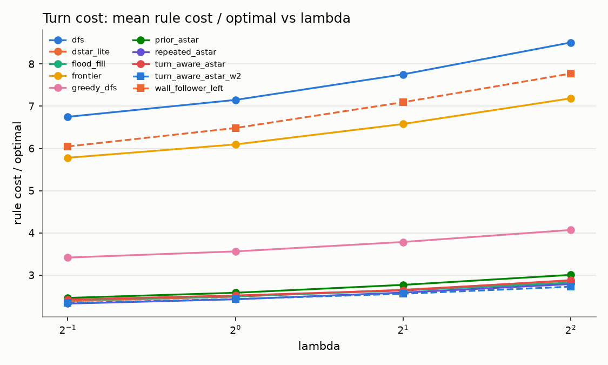
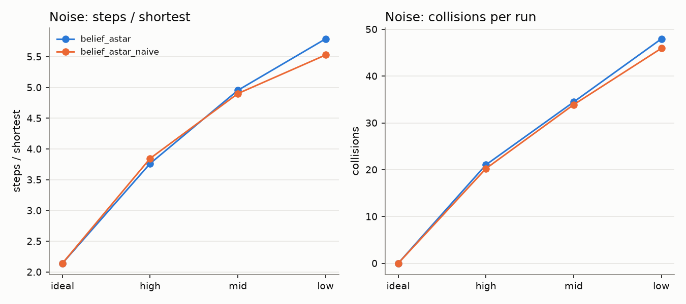
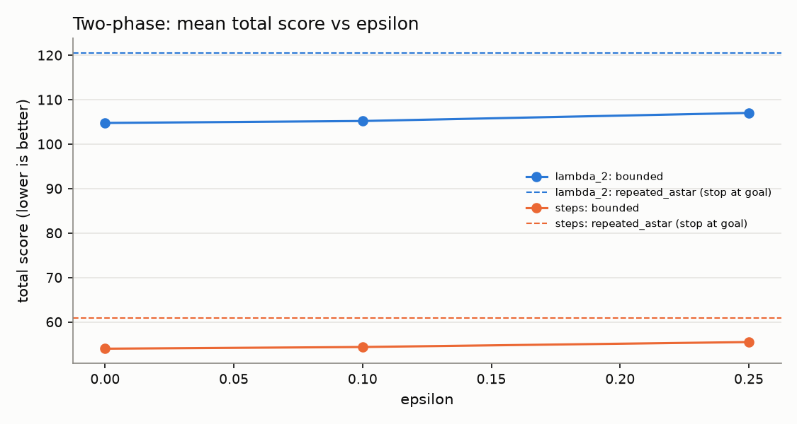

# 扩展实验分析

按冻结的 [实验计划](../../../Docs/ext/experiment-plan.md) 第 5 节：配对胜负（a 相对 b，a 更好记胜）、双侧符号检验（p < 0.05）、外部迷宫库与生成图两组方向一致才写总体结论。由 `python src/ext/analysis.py` 生成。

## X1 转弯代价与运动时间（Q1～Q4）

### Q1 朝向 A* 与重复 A*（主指标：规则代价 / 最优，越低越好）

| 比较 | 全部：胜/负/平 | 外部迷宫库 | 生成图 | 结论 |
| --- | --- | --- | --- | --- |
| lambda_0.5：turn_aware_astar vs repeated_astar | 162/189/84（p = 0.165） | 119/138/58（p = 0.261） | 43/51/26（p = 0.47） | **无显著差异** |
| lambda_1：turn_aware_astar vs repeated_astar | 174/174/87（p = 1） | 127/127/61（p = 1） | 47/47/26（p = 1） | **无显著差异** |
| lambda_2：turn_aware_astar vs repeated_astar | 186/168/81（p = 0.366） | 137/121/57（p = 0.35） | 49/47/24（p = 0.919） | **无显著差异** |
| lambda_4：turn_aware_astar vs repeated_astar | 184/170/81（p = 0.49） | 134/126/55（p = 0.664） | 50/44/26（p = 0.606） | **无显著差异** |
| motion_time：turn_aware_astar vs repeated_astar | 184/173/78（p = 0.597） | 136/126/53（p = 0.578） | 48/47/25（p = 1） | **无显著差异** |

### Q2 平均代价比排名（成功运行；括号内为成功率）

| 子实验 | 第 1 | 第 2 | 第 3 | 最差 |
| --- | --- | --- | --- | --- |
| lambda_0.5 | repeated_astar 2.326（100%） | turn_aware_astar_w2 2.339（100%） | dstar_lite 2.383（100%） | dfs 6.749（100%） |
| lambda_1 | repeated_astar 2.428（100%） | turn_aware_astar_w2 2.433（100%） | dstar_lite 2.489（100%） | dfs 7.149（100%） |
| lambda_2 | turn_aware_astar_w2 2.559（100%） | repeated_astar 2.586（100%） | flood_fill 2.636（100%） | dfs 7.754（100%） |
| lambda_4 | turn_aware_astar_w2 2.726（100%） | repeated_astar 2.787（100%） | flood_fill 2.821（100%） | dfs 8.508（100%） |
| motion_time | turn_aware_astar_w2 2.413（100%） | repeated_astar 2.419（100%） | flood_fill 2.477（100%） | dfs 7.094（100%） |

### Q3 加权 A*（w = 2）与 w = 1

| 比较 | 全部：胜/负/平 | 外部迷宫库 | 生成图 | 结论 |
| --- | --- | --- | --- | --- |
| lambda_0.5：代价比，w2 vs w1 | 92/116/227（p = 0.111） | 82/109/124（p = 0.0596） | 10/7/103（p = 0.629） | **无显著差异** |
| lambda_0.5：扩展状态数，w2 vs w1 | 295/138/2（p = 3.44e-14） | 187/126/2（p = 0.000671） | 108/12/0（p = 1.78e-20） | **更好** |
| lambda_1：代价比，w2 vs w1 | 84/97/254（p = 0.372） | 74/91/150（p = 0.213） | 10/6/104（p = 0.454） | **无显著差异** |
| lambda_1：扩展状态数，w2 vs w1 | 329/104/2（p = 2.76e-28） | 215/98/2（p = 3.27e-11） | 114/6/0（p = 5.8e-27） | **更好** |
| lambda_2：代价比，w2 vs w1 | 76/79/280（p = 0.872） | 66/72/177（p = 0.671） | 10/7/103（p = 0.629） | **无显著差异** |
| lambda_2：扩展状态数，w2 vs w1 | 350/84/1（p = 1.16e-39） | 235/79/1（p = 3.89e-19） | 115/5/0（p = 3e-28） | **更好** |
| lambda_4：代价比，w2 vs w1 | 72/74/289（p = 0.934） | 63/67/185（p = 0.793） | 9/7/104（p = 0.804） | **无显著差异** |
| lambda_4：扩展状态数，w2 vs w1 | 360/73/2（p = 1.17e-46） | 244/71/0（p = 2.29e-23） | 116/2/2（p = 4.23e-32） | **更好** |
| motion_time：代价比，w2 vs w1 | 76/97/262（p = 0.128） | 69/91/155（p = 0.0966） | 7/6/107（p = 1） | **无显著差异** |
| motion_time：扩展状态数，w2 vs w1 | 349/84/2（p = 1.87e-39） | 235/79/1（p = 3.89e-19） | 114/5/1（p = 5.74e-28） | **更好** |

### Q4 D* Lite 与重复 A*（计算时间：3 次重复的中位数，毫秒）

| 比较 | 全部：胜/负/平 | 外部迷宫库 | 生成图 | 结论 |
| --- | --- | --- | --- | --- |
| lambda_0.5：计算时间，dstar_lite vs repeated_astar | 1/434/0（p = 9.83e-129） | 1/314/0（p = 9.47e-93） | 0/120/0（p = 1.5e-36） | **更差** |
| lambda_1：计算时间，dstar_lite vs repeated_astar | 2/433/0（p = 2.14e-126） | 2/313/0（p = 1.49e-90） | 0/120/0（p = 1.5e-36） | **更差** |
| lambda_2：计算时间，dstar_lite vs repeated_astar | 2/433/0（p = 2.14e-126） | 2/313/0（p = 1.49e-90） | 0/120/0（p = 1.5e-36） | **更差** |
| lambda_4：计算时间，dstar_lite vs repeated_astar | 6/429/0（p = 2.08e-118） | 6/309/0（p = 3.95e-83） | 0/120/0（p = 1.5e-36） | **更差** |
| motion_time：计算时间，dstar_lite vs repeated_astar | 4/431/0（p = 3.35e-122） | 4/311/0（p = 1.22e-86） | 0/120/0（p = 1.5e-36） | **更差** |

计算时间中位数（lambda_0.5）：dstar_lite 5.23 ms，repeated_astar 2.12 ms。

路线完全相同的地图：338/435（78%；两种算法都只按步数选路，路线与代价规则无关，因此在基础规则下重新运行比较）。

## X2 噪声观测（Q5、Q6）

### Q5 置信度融合与只信最近读数（主指标：步数 / 最短路，按地图 × 种子配对）

| 比较 | 全部：胜/负/平 | 外部迷宫库 | 生成图 | 结论 |
| --- | --- | --- | --- | --- |
| high：belief_astar vs naive | 349/322/329（p = 0.316） | 185/185/30（p = 1） | 164/137/299（p = 0.134） | **无显著差异** |
| high：撞墙次数，belief_astar vs naive | 307/342/351（p = 0.182） | 167/199/34（p = 0.105） | 140/143/317（p = 0.905） | **无显著差异** |
| ideal：belief_astar vs naive | 0/0/1000（p = 1） | 0/0/400（p = 1） | 0/0/600（p = 1） | **无显著差异** |
| low：belief_astar vs naive | 440/500/60（p = 0.0543） | 203/189/8（p = 0.511） | 237/311/52（p = 0.00179） | **无显著差异** |
| low：撞墙次数，belief_astar vs naive | 425/517/58（p = 0.00301） | 197/198/5（p = 1） | 228/319/53（p = 0.000115） | **更差** |
| mid：belief_astar vs naive | 441/417/142（p = 0.432） | 213/180/7（p = 0.106） | 228/237/135（p = 0.711） | **无显著差异** |
| mid：撞墙次数，belief_astar vs naive | 417/429/154（p = 0.705） | 202/189/9（p = 0.544） | 215/240/145（p = 0.261） | **无显著差异** |

### Q6 各档噪声与理想观测（均值；成功率含全部运行）

| 子实验 | 算法 | 成功率 | 步数 / 最短路 | 撞墙次数 |
| --- | --- | --- | --- | --- |
| high | belief_astar | 100.0% | 3.764 | 21.0 |
| high | belief_astar_naive | 100.0% | 3.847 | 20.2 |
| ideal | belief_astar | 100.0% | 2.141 | 0.0 |
| ideal | belief_astar_naive | 100.0% | 2.141 | 0.0 |
| low | belief_astar | 100.0% | 5.791 | 48.0 |
| low | belief_astar_naive | 100.0% | 5.529 | 45.9 |
| mid | belief_astar | 100.0% | 4.955 | 34.5 |
| mid | belief_astar_naive | 100.0% | 4.901 | 33.9 |

## X3 两阶段比赛（Q7）

### 均值（成功运行）

| 子实验 | 算法 | 成功率 | 探索代价（含返回） | 冲刺 / 最优 | 成绩 |
| --- | --- | --- | --- | --- | --- |
| lambda_2 | repeated_astar | 100.0% | 317.2 | 1.258 | 120.46 |
| lambda_2 | flood_fill | 100.0% | 321.3 | 1.251 | 120.00 |
| lambda_2 | turn_aware_astar | 100.0% | 322.0 | 1.257 | 120.48 |
| lambda_2 | bounded_explore_e0 | 100.0% | 459.7 | 1.000 | 104.79 |
| lambda_2 | bounded_explore_e10 | 100.0% | 429.3 | 1.014 | 105.23 |
| lambda_2 | bounded_explore_e25 | 100.0% | 397.1 | 1.044 | 107.05 |
| steps | repeated_astar | 100.0% | 150.1 | 1.207 | 60.92 |
| steps | flood_fill | 100.0% | 155.1 | 1.218 | 61.37 |
| steps | turn_aware_astar | 100.0% | 154.1 | 1.216 | 61.00 |
| steps | bounded_explore_e0 | 100.0% | 197.0 | 1.000 | 54.02 |
| steps | bounded_explore_e10 | 100.0% | 187.2 | 1.013 | 54.40 |
| steps | bounded_explore_e25 | 100.0% | 178.2 | 1.046 | 55.51 |

### 理论保证核对：冲刺 / 最优 ≤ 1 + ε

- lambda_2 / bounded_explore_e0：最大冲刺 / 最优 = 1.0000，上限 1 → 成立
- lambda_2 / bounded_explore_e10：最大冲刺 / 最优 = 1.1000，上限 1.1 → 成立
- lambda_2 / bounded_explore_e25：最大冲刺 / 最优 = 1.2464，上限 1.25 → 成立
- steps / bounded_explore_e0：最大冲刺 / 最优 = 1.0000，上限 1 → 成立
- steps / bounded_explore_e10：最大冲刺 / 最优 = 1.1000，上限 1.1 → 成立
- steps / bounded_explore_e25：最大冲刺 / 最优 = 1.2500，上限 1.25 → 成立

### 成绩配对比较（越低越好）

| 比较 | 全部：胜/负/平 | 外部迷宫库 | 生成图 | 结论 |
| --- | --- | --- | --- | --- |
| lambda_2：bounded_explore_e0 vs repeated_astar | 294/127/14（p = 2.41e-16） | 240/71/4（p = 1.32e-22） | 54/56/10（p = 0.924） | **取决于地图来源** |
| lambda_2：bounded_explore_e0 vs flood_fill | 280/136/19（p = 1.42e-12） | 236/74/5（p = 7.24e-21） | 44/62/14（p = 0.0982） | **取决于地图来源** |
| lambda_2：bounded_explore_e0 vs turn_aware_astar | 280/133/22（p = 3.84e-13） | 235/73/7（p = 5.25e-21） | 45/60/15（p = 0.172） | **取决于地图来源** |
| lambda_2：bounded_explore_e10 vs repeated_astar | 284/136/15（p = 4.23e-13） | 230/81/4（p = 1.1e-17） | 54/55/11（p = 1） | **取决于地图来源** |
| lambda_2：bounded_explore_e10 vs flood_fill | 259/150/26（p = 7.83e-08） | 217/88/10（p = 9.9e-14） | 42/62/16（p = 0.0619） | **取决于地图来源** |
| lambda_2：bounded_explore_e10 vs turn_aware_astar | 254/147/34（p = 1.02e-07） | 212/87/16（p = 3.37e-13） | 42/60/18（p = 0.0918） | **取决于地图来源** |
| lambda_2：bounded_explore_e25 vs repeated_astar | 273/144/18（p = 2.65e-10） | 214/96/5（p = 1.74e-11） | 59/48/13（p = 0.334） | **更好** |
| lambda_2：bounded_explore_e25 vs flood_fill | 237/153/45（p = 2.46e-05） | 196/105/14（p = 1.73e-07） | 41/48/31（p = 0.525） | **取决于地图来源** |
| lambda_2：bounded_explore_e25 vs turn_aware_astar | 227/143/65（p = 1.47e-05） | 187/99/29（p = 2.17e-07） | 40/44/36（p = 0.744） | **取决于地图来源** |
| steps：bounded_explore_e0 vs repeated_astar | 277/136/22（p = 3.49e-12） | 226/82/7（p = 9.99e-17） | 51/54/15（p = 0.845） | **取决于地图来源** |
| steps：bounded_explore_e0 vs flood_fill | 284/107/44（p = 1.29e-19） | 228/74/13（p = 2.06e-19） | 56/33/31（p = 0.0192） | **更好** |
| steps：bounded_explore_e0 vs turn_aware_astar | 271/117/47（p = 3.48e-15） | 222/79/14（p = 6.95e-17） | 49/38/33（p = 0.284） | **更好** |
| steps：bounded_explore_e10 vs repeated_astar | 258/150/27（p = 9.97e-08） | 209/98/8（p = 2.2e-10） | 49/52/19（p = 0.842） | **取决于地图来源** |
| steps：bounded_explore_e10 vs flood_fill | 259/106/70（p = 6.64e-16） | 210/84/21（p = 1.31e-13） | 49/22/49（p = 0.00182） | **更好** |
| steps：bounded_explore_e10 vs turn_aware_astar | 225/112/98（p = 7.37e-10） | 188/92/35（p = 9.9e-09） | 37/20/63（p = 0.0331） | **更好** |
| steps：bounded_explore_e25 vs repeated_astar | 220/184/31（p = 0.0815） | 173/134/8（p = 0.0299） | 47/50/23（p = 0.839） | **无显著差异** |
| steps：bounded_explore_e25 vs flood_fill | 199/138/98（p = 0.00105） | 163/126/26（p = 0.034） | 36/12/72（p = 0.000717） | **更好** |
| steps：bounded_explore_e25 vs turn_aware_astar | 158/140/137（p = 0.325） | 136/131/48（p = 0.807） | 22/9/89（p = 0.0294） | **无显著差异** |

## 图

